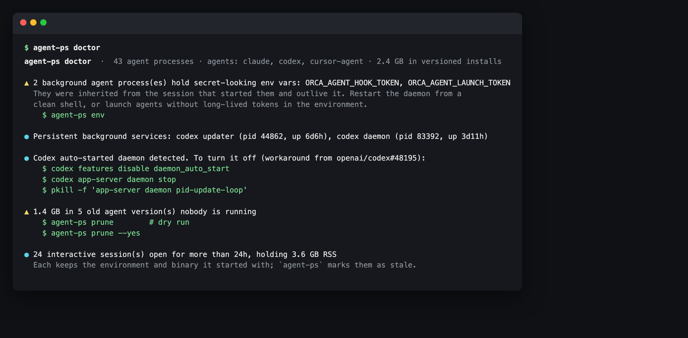
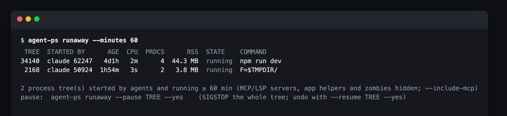
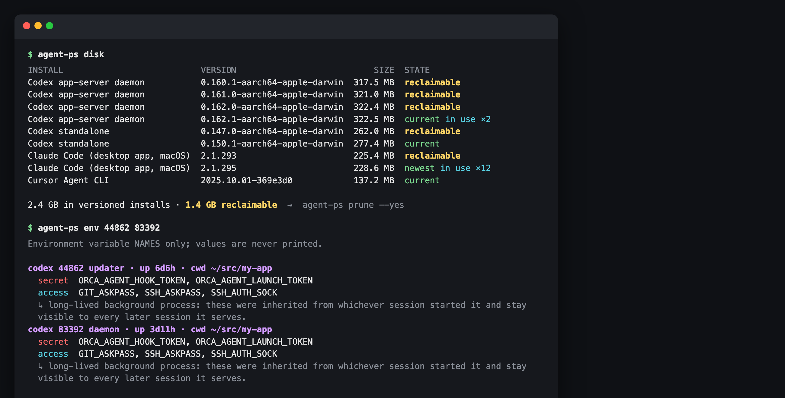

# agent-ps

**`ps` + `du` + env audit for the coding agents on your machine.** See which Claude Code / Codex / Cursor Agent / Gemini CLI processes are running, which ones became background daemons, which tokens they inherited, how many gigabytes of old agent versions nobody runs anymore, and which background jobs they started and never stopped.

<!-- agent-preflight -->
> **Also a Claude Code skill.** `agent-ps` is part of [agent-preflight](https://github.com/thinx-pro/agent-preflight), 16 offline checks for coding agents: `/plugin marketplace add thinx-pro/agent-preflight` then `/plugin install agent-ps@agent-preflight`, and ask Claude in plain words.

   



<sub>Real output from the author's Mac (one project path renamed). 43 agent processes, a 6-day-old Codex updater loop, and 1.4 GB of old versions.</sub>

## Why

Coding agents are quietly turning from CLI tools into resident system services:

- Since Codex CLI 0.157, opening an interactive session starts a **persistent app-server daemon** plus a **detached self-updater**. The daemon runs from a ~374 MB copy of the platform package under `~/.codex/packages/app-server-daemon/releases/<version>/` and **keeps the environment of whichever session happened to start it** ([openai/codex#48195](https://github.com/openai/codex/issues/48195), discussed on Hacker News). `daemon stop` doesn't stop the updater loop.
- Agents keep one full copy per version (Codex releases, the Claude desktop app's bundled Claude Code, Cursor Agent's `versions/`), and nothing cleans them up.
- People leave dozens of sessions open for days; each one keeps the binary and the environment it started with.

There is no `ps` for this. You end up with `pgrep`, `du -sh ~/.codex/*` and `pkill`. agent-ps puts it on one screen, across agents.

### New in 0.2.0: `agent-ps runaway`

Agents start things in the background (test loops, dev servers, watchers) and move on. [One r/ClaudeAI user reports](https://www.reddit.com/r/ClaudeAI/comments/1x540si/psa_claude_code_wrote_me_an_uncapped_test_loop/) that Claude Code ran an uncapped test loop against a paid API for **17 hours (about $2,100)** while telling them it was idle. `runaway` lists every process tree an agent started that is still running after N minutes. It can pause a tree (`SIGSTOP`, resumable), resume it, or terminate it, and in `--watch` mode it can auto-pause new ones overnight.



<sub>Real output on the author's Mac (one temp path redacted): a <code>npm run dev</code> a Claude Code session started four days ago, still running.</sub>

```bash
agent-ps runaway                          # trees started by agents, running ≥ 30 min
agent-ps runaway --pause 34140 --yes      # SIGSTOP the whole tree (undo: --resume 34140 --yes)
agent-ps runaway --watch 300 --minutes 120 --auto-pause   # overnight: pause anything left running > 2h
```

## Quick start

```bash
pipx run --spec git+https://github.com/thinx-pro/agent-ps agent-ps doctor
```

Or install it (`pipx install git+https://github.com/thinx-pro/agent-ps`, or `pip install` the same URL) and run `agent-ps doctor`. No dependencies beyond Python 3.8+.

## Commands

| Command | What it shows |
|---|---|
| `agent-ps` | Every agent process: agent, PID, kind (`session` / `daemon` / `updater` / `detached` / `desktop` / `helper`), version, age, RSS, TTY, parent, flags (`N secret env`, `orphan`, `stale`) |
| `agent-ps env [PID...]` | Secret-looking **environment variable names** each agent process holds. Background processes are listed one by one with their working directory |
| `agent-ps disk` | Versioned installs with size and state: `current`, `in use ×N`, `reclaimable` |
| `agent-ps doctor` | Findings with suggested commands. `--strict` exits 1 on warnings |
| `agent-ps prune [--yes]` | Deletes old versions that are neither current nor in use. **Dry run unless `--yes`** |
| `agent-ps runaway` | Process trees started by agents (Bash-tool commands, test loops, dev servers) running ≥ `--minutes` (default 30): age, CPU, process count, RSS, running/busy/paused, and the command the agent actually launched (shell wrappers unwrapped, credential-looking values masked). `--pause` / `--resume` / `--kill TREE --yes`, `--watch SECONDS [--auto-pause]`, `--include-mcp`, `--strict` |

Common flags: `--json` (home directory is shown as `~`), `--all` (include helper processes), `--stale HOURS` (default 24), `--keep N` (keep N extra old versions per install), `--no-color`.



## What it detects

**Processes.** Agents are recognised by executable path and argv (including `node …/@google/gemini-cli/…` style launches): Claude Code, Codex, Cursor Agent, Gemini CLI, OpenCode, Copilot CLI, Aider, Amp, Goose, Qwen Code, Crush. The kind is inferred from argv and location. For example, `codex app-server daemon pid-update-loop` is the `updater`, a binary under `app-server-daemon/` is the `daemon`, and Claude Code spawned from the desktop app is `desktop`.

**Environment.** Argv and environment are read with `sysctl(KERN_PROCARGS2)` on macOS and `/proc/<pid>/environ` on Linux, only for processes you own. Each variable is classified as:
- `secret`: name looks like a credential (`*TOKEN*`, `*SECRET*`, `*API_KEY*`, `*PASSWORD*`, …) with a non-trivial value, or the value has a well-known token shape (`ghp_`, `github_pat_`, `sk-`, `AKIA`, `xox?-`, `glpat-`, JWT, …) whatever the name.
- `access`: indirect credential access (`SSH_AUTH_SOCK`, `GIT_ASKPASS`, `KUBECONFIG`, `AWS_PROFILE`, …).

**Values are never printed, stored or written to JSON.** They are only used to decide the class. A secret in an interactive session is often intentional, so `doctor` only warns when a *background* process (daemon, updater, detached) holds one: those outlive the session that started them.

**Disk.** Known layouts:

| Install | Location |
|---|---|
| Codex app-server daemon | `~/.codex/packages/app-server-daemon/releases/*` (`current` symlink) |
| Codex standalone | `~/.codex/packages/standalone/releases/*` |
| Claude Code native installer | `~/.local/share/claude/versions/*` (`~/.local/bin/claude` symlink) |
| Claude Code bundled with the desktop app | `~/Library/Application Support/Claude/claude-code/*`, `~/.config/Claude/claude-code/*` |
| Cursor Agent CLI | `~/.local/share/cursor-agent/versions/*` |
| OpenCode | `~/.opencode/versions/*` |

A version is **kept** if a `current` link points at it, if any running process executes from it, or (when there is no link) if it's the newest. Everything else is `reclaimable`. `prune` re-checks that every path sits directly inside its install root and never follows symlinks.

**Runaways.** Every direct child of an agent process is the root of a tree, together with all its descendants. MCP and language servers, helpers bundled inside `.app` packages, zombies and small tooling (`caffeinate`, `rg`) are hidden by default, because they are long-lived by design. `--pause` sends `SIGSTOP` to every process in the tree, leaves first. A stopped loop can't spawn its next iteration, and `--resume` sends `SIGCONT`. Only tree roots from the current scan are accepted, and nothing is signalled without `--yes`. agent-ps doesn't know what a process costs: "busy" means CPU time above 20 % of wall time, and a loop that mostly waits on a paid API looks idle. Treat age as the signal.

## Doctor findings

- ▲ process trees started by an agent and still running after 60 min (new in 0.2.0)
- ▲ background agent processes holding secret-looking env vars
- ● persistent background services (daemons, updaters) and their age
- ● Codex auto-started daemon, with the off switch from [#48195](https://github.com/openai/codex/issues/48195): `codex features disable daemon_auto_start`, `codex app-server daemon stop`, `pkill -f 'app-server daemon pid-update-loop'`
- ▲ processes still running an older binary than the installed current version
- ▲ reclaimable old versions (≥ 50 MB)
- ● interactive sessions older than `--stale` hours, with their total RSS
- ▲ orphaned agent processes (parent exited)

## Limitations and roadmap

- Read-only except `prune --yes` and `runaway --pause/--resume/--kill --yes`. Everything else only prints the commands, so you stay in control.
- `runaway` sees processes, not bills: it can't tell which loop calls a paid API. A tree that an agent started and then detached (`nohup … &`, re-parented to launchd/init) is no longer under the agent and isn't listed.
- Tested on macOS (Apple Silicon) against real Claude Code, Codex (CLI, daemon, desktop) and Cursor Agent installs. The Linux `/proc` path is implemented but has not yet been exercised on a real Linux box. Windows isn't supported.
- The secret classifier is heuristic. Expect occasional false positives (a `*_TOKEN` that's really an ID) and misses (a credential under an innocent name with an unknown format).
- The desktop apps manage their own bundled versions. Pruning an old one is safe while nothing runs it, but the app may download it again.
- Roadmap: `pin` / delayed-update policy per agent, binary digests, a menu-bar view, a hook that gives each background command a time budget, detached (`nohup`) trees traced by session, more install layouts (npm/Homebrew multi-versions, Nix). PRs adding layouts are very welcome.

## Development

```bash
python3 -m unittest discover -s tests -v
python3 -m agent_ps doctor
```

`scripts/shoot.py` regenerates the README screenshots from live output.

## License

MIT

---

### 中文说明

agent-ps 是给编码 Agent 用的 `ps` + `du` + 环境变量体检工具。一条命令列出本机 Claude Code、Codex、Cursor Agent、Gemini CLI 等的进程，区分会话、守护进程、更新器和桌面端子进程，并显示版本、存活时间和内存。它会标出后台进程从启动它的那个会话继承来的 TOKEN / KEY 类环境变量，只显示变量名，绝不输出值。它还会统计各 Agent 按版本保留的安装目录，找出没人在用、可以回收的旧版本，`prune` 默认只预演，加 `--yes` 才删除。作者自己的 Mac 上实测：Codex 更新器常驻 6 天，带着两个令牌变量；旧版本可回收 1.4 GB。0.2.0 新增 `agent-ps runaway`：列出由 Agent 拉起、运行超过 N 分钟仍未结束的进程树，例如后台测试循环、dev server、监视器，并显示真实启动的命令（凭据类值会打码）。可以 `--pause`（SIGSTOP，可 `--resume` 恢复）或 `--kill`，`--watch --auto-pause` 适合夜间无人值守。作者机器上实测发现一个 4 天前由 Claude Code 启动、至今仍在运行的 `npm run dev`。零依赖，Python 3.8+：`pipx run --spec git+https://github.com/thinx-pro/agent-ps agent-ps doctor`。
